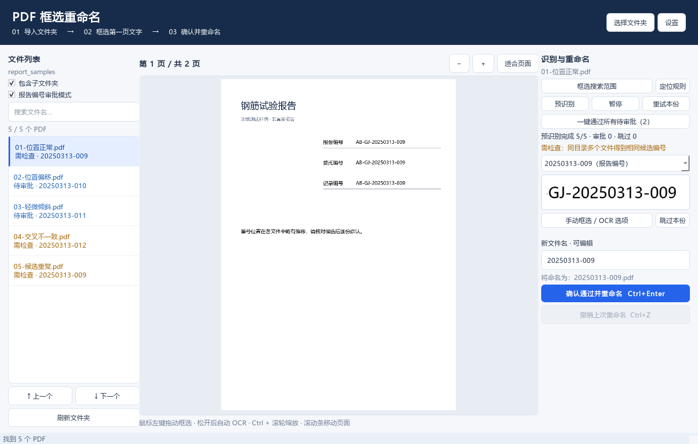

# PDF 框选重命名

Windows 本地 PDF OCR 重命名工具。支持拖入文件夹、预览第一页、框选识别，以及报告编号的自动定位、逐份确认和批量审批。PDF 内容和 OCR 输入均在本机处理。

## 下载运行

在 [Releases](https://github.com/ThirdFC/pdf-report-renamer/releases) 下载 Windows x64 软件包，解压整个文件夹，运行 `PDF框选重命名.exe`。

需要保留 `_internal` 文件夹。成品无需另装 Python、Adobe Acrobat 或 OCR 软件。当前版本为 **1.3.2**，在 Windows 11 x64 验证。

## 报告编号审批

1. 导入文件夹，勾选左侧“报告编号审批模式”。
2. 首次点击“框选搜索范围”，框一个较大的区域，包含“报告编号”及右侧完整号码，换行时包含两行；尽量覆盖附近的委托编号、记录编号。
3. 软件后台识别第一页，提取 `20250313-009` 这样的编号，并显示原始扫描截图。位置在范围内有偏移时仍会自动定位。
4. 核对候选与截图，按自己配置的确认键，或点击“确认通过并重命名”。此时才改名并进入下一份。
5. 发现异常可改候选、手动框选、重试或跳过。

**预识别不会自动改名；逐份确认或点击“一键通过所有待审批”后才执行。** 模型分歧、交叉编号不一致、格式问题和重复名称会提示检查；已存在的文件不会被覆盖。原文件名已经匹配时，只记录本次审批。

### 双行报告编号

1.3.2 修复双行编号的定位。定位文字可以在第一行旁，也可以居中位于两行旁；例如第一行 `HSZQXI-ZTJDQ-J0-HJW-`、第二行 `20250721-001`，会提取 `20250721-001`。日期或流水号本身换行时，也会在同一字段内尝试拼接相邻、对齐的两行。

附近其他字段文字会限制上下和横向范围，减少误取相邻编号。多个完整结果仍会提示检查。审批证据包含定位文字和完整编号，搜索范围需覆盖两行。升级后重试当前文件或重新导入文件夹。

### 一键通过所有待审批

1.3.1 新增批量通过按钮，显示当前可处理的数量。一次点击通过并重命名所有已预识别完成、无检查提示且未手动修改的“待审批”文件，**包含被搜索筛选隐藏的项目**。

“需检查”“手动待确认”、已跳过和仍在识别的文件不处理；点击后新识别出的候选不自动加入本次。运行中可点击“停止批量通过”，完成后显示改名、原名匹配、失败和未处理的数量。改名失败或文件变化会保留并标记，其他项目继续处理。批量改名仍可逐次撤销。



搜索范围与定位规则会保存。候选与审批状态只保留在本次会话，重启后需要重新预识别。格式或交叉核对通过仍可能有 OCR 错误，需要对照截图审批。

## 手动 OCR 功能

- 拖入文件夹，可包含子文件夹；预览并识别 PDF 第一页。
- 矩形框选后自动 OCR；支持中英文、数字和人工修改。
- PP-OCRv6、PP-OCRv4 模型切换与双模型候选对比，离线推理。
- 选区独立以 300 / 450 / 600 DPI 渲染，支持对比度增强、黑白增强及轻微倾斜纠正。
- OCR 结果去空格，可选删除首位符号；只删除开头的一个符号。
- 跨文件保留预览缩放与浏览位置；普通手动模式切换文件会清除精细选区。
- 可配置快捷键、重名保护与本次会话的撤销重命名。

默认确认快捷键是 `Ctrl+Enter`，可在“设置”中修改。已有本地快捷键设置继续保留。

完整说明见 [使用说明](使用说明.txt)。`report_samples`、`multiline_samples` 和 `test_documents` 均为生成的测试文件，不含真实业务报告。

## 源码运行与测试

使用 Windows x64、Python 3.12：

```powershell
py -3.12 -m venv .venv
.\.venv\Scripts\python.exe -m pip install -r src\requirements.txt
.\.venv\Scripts\python.exe src\app.py
```

运行测试：

```powershell
.\.venv\Scripts\python.exe -m pytest src\tests -q
```

1.3.2 发布时本机 **129 项测试通过**，并验证打包程序的逐份审批、批量通过、异常项目不动、撤销及 PDF 字节内容保持。另用四份无文字层双行 PDF 验证两个模型的完整后缀提取及交叉不一致提示。验证记录见 [单份审批](docs/packaged-review-check.json)、[批量审批](docs/packaged-bulk-check.json) 与 [双行编号](docs/packaged-multiline-check.json)。用户实际扫描件的识别效果仍需核对。

重新生成虚构样例：

```powershell
.\.venv\Scripts\python.exe src\make_samples.py
.\.venv\Scripts\python.exe src\make_report_samples.py
```

## 构建 Windows 成品

```powershell
.\src\build.ps1
```

构建脚本在 `src/.venv` 中安装锁定的依赖，通过 PyInstaller 生成 `src/dist/PDF框选重命名`。分发时保留整个程序目录，并携带源码、使用说明与第三方许可。无需把大体积软件包或模型权重提交到 Git；成品通过 GitHub Releases 分发。

源码结构和打包诊断参数见 [开发说明](src/开发说明.txt)。

## 许可

应用源码按 [AGPL-3.0-or-later](LICENSE) 提供。PyMuPDF、Qt/PySide6、RapidOCR、PP-OCR 模型等保留各自许可，见 [licenses](licenses)。成品 ZIP 包含应用源码和第三方许可说明。
